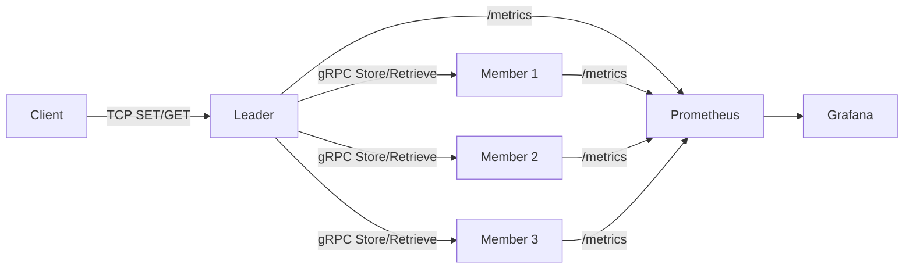

<div align="center">


<h1>Tolerex - HaToKuSe Distributed Message Storage System</h1>

<p>
  
  
  
  
  
</p>

<p>
  <b>Tolerex</b> is a <b>fault-tolerant distributed message storage system</b><br/>
  developed as part of the <b>System Programming</b> course.
</p>

<p>
  Leader-based architecture | Configurable replication factor |
  Crash-tolerant reads | Disk persistence | Secure gRPC communication
</p>

<p>
  <a href="#quick-start">Quick Start</a> |
  <a href="#architecture">Architecture</a> |
  <a href="#test-scenarios">Test Scenarios</a> |
  <a href="#project-structure">Project Structure</a>
</p>

</div>

## Contents

- [Overview](#overview)
- [Technology Stack](#technology-stack)
- [Quick Start](#quick-start)
- [Monitoring](#monitoring)
- [Service Ports](#service-ports)
- [Configuration](#configuration)
- [Architecture](#architecture)
- [Test Client](#test-client)
- [Operational Tips](#operational-tips)
- [Troubleshooting](#troubleshooting)
- [Performance Notes](#performance-notes)
- [Project Structure](#project-structure)
- [Testing and Cleanup](#testing-and-cleanup)
- [Test Scenarios](#test-scenarios)
- [Roadmap and References](#roadmap-and-references)

## Overview

Core capabilities:

- Replication and fault tolerance
- Load-balanced write placement
- Crash-aware read fallback
- Disk-backed persistence
- Secure inter-node communication with mTLS

Client interaction uses a text protocol called HaToKuSe.

Current scope:

- Single leader process (no leader election yet)
- Strong focus on local/dev cluster workflows
- Course-project oriented architecture with clear, inspectable code paths

## Technology Stack

| Layer | Technology | Purpose |
| :--- | :--- | :--- |
| Language | Go 1.24+ | Core implementation |
| RPC | gRPC + Protobuf | Leader-member communication |
| Transport Security | mTLS | Mutual node authentication |
| Metrics | Prometheus | Time-series collection |
| Visualization | Grafana | Operational dashboarding |
| Local Orchestration | Docker Compose | Repeatable local deploy |

## Quick Start

### Prerequisites

- Go 1.24+
- Protocol Buffers compiler (`protoc`) for regenerating `.proto` files (optional)
- OpenSSL for certificate generation (certificates are already included)
- Docker and Docker Compose for monitoring (optional)

### Install

```bash
git clone https://github.com/YasinEnginExpert/Tolerex.git
cd Tolerex
go mod tidy
```

### Verify Build

```bash
go build ./cmd/leader
go build ./cmd/client
go build ./cmd/member
go build ./cmd/launcher
```

### Option 1: Automated Local Launch (Windows)

```bash
go run ./cmd/launcher/main.go
```

The launcher starts leader and members in separate terminals.
Stress clients are optional (set client count to `0` to skip).
Recommended values: `6` members and `4` stress clients.
Note: enter these values explicitly in the launcher prompts.

### Option 2: Manual Host Launch

Leader:

```powershell
$env:LEADER_GRPC_PORT='5555'
$env:LEADER_METRICS_PORT='9090'
go run ./cmd/leader/main.go
```

Member:

```powershell
$env:LEADER_ADDR='localhost:5555'
$env:MEMBER_ADDR='localhost:5556'
go run ./cmd/member/main.go -port=5556 -metrics=9092 -io=buffered
```

Client:

```bash
go run ./cmd/client/main.go
go run ./cmd/client/main.go -measure
go run ./cmd/client/main.go -measure -csv > measured/client.csv
go run ./cmd/client/main.go -measure -csv -id client-1 -offset 0
go run ./cmd/client/main.go -measure -csv -id client-2 -offset 100000
```

### Option 3: Full Docker Cluster Launch

```bash
docker compose -f deploy/docker-compose.cluster.yml up -d --build
# or: make deploy-cluster-up
```

Stop:

```bash
docker compose -f deploy/docker-compose.cluster.yml down
# or: make deploy-cluster-down
```

After cluster startup, run clients from host (example):

```bash
make stress-client-30m
```

30-minute continuous measured stress client:

```bash
make stress-client-30m
```

30-minute continuous measured stress clients (parallel):

```bash
make stress-clients-30m
```

Quick interactive commands:

```text
SET 1 hello
GET 1
1000 SET load_test
QUIT
```

Quick health check after startup:

```bash
curl http://localhost:9090/metrics
```

If member metrics are enabled, also check:

```bash
curl http://localhost:9092/metrics
```

## Monitoring

Monitoring-only mode (Leader/Member on host):

```bash
docker compose -f deploy/docker-compose.yml up -d
# or: make deploy-monitoring-up
```

Full Docker cluster mode (Leader + Members + Monitoring):

```bash
docker compose -f deploy/docker-compose.cluster.yml up -d --build
# or: make deploy-cluster-up
```

Note: deploy Compose files intentionally do not run client containers.
Run clients separately (for example `make stress-client-30m`).

Access:

- Prometheus targets: `http://localhost:9091/targets`
- Grafana UI: `http://localhost:3000` (default `admin/admin`)

Import dashboard:

- `deploy/grafana_dashboard.json`
- Detailed deploy guide: `deploy/manual.md`
- Datasource/dashboard provisioning is automatic on startup (no manual datasource setup required)

The dashboard now includes:

- SRE summary KPIs (throughput, error rate, p95, p99)
- Throughput/error breakdown by method and status
- Instance-level throughput and scrape health
- Stored message totals per member instance
- Top methods by load for bottleneck analysis

## Service Ports

| Service | Default Port | Notes |
| :--- | :--- | :--- |
| Leader gRPC | `5555` | Member registration and replication path |
| Leader TCP | `6666` | Client command protocol (HaToKuSe) |
| Leader Metrics | `9090` | Prometheus scrape endpoint |
| Member-1 gRPC | `5556` | Storage RPC |
| Member-2 gRPC | `5557` | Storage RPC |
| Member-3 gRPC | `5558` | Storage RPC |
| Member-4 gRPC | `5559` | Storage RPC |
| Member-5 gRPC | `5560` | Storage RPC |
| Member-6 gRPC | `5561` | Storage RPC |
| Member Metrics | `9092-9097` | Prometheus scrape endpoints |
| Prometheus UI | `9091` | Exposed from container port `9090` |
| Grafana UI | `3000` | Dashboard and alerting UI |

## Configuration

| Variable | Example | Description |
| :--- | :--- | :--- |
| `LEADER_GRPC_PORT` | `5555` | Leader gRPC port |
| `LEADER_TCP_PORT` | `6666` | Leader TCP command port |
| `LEADER_TCP_BIND` | `127.0.0.1` or `0.0.0.0` | Leader TCP bind host |
| `LEADER_METRICS_PORT` | `9090` | Leader metrics port |
| `LEADER_ADDR` | `localhost:5555` | Member -> Leader registration/heartbeat target |
| `MEMBER_ADDR` | `localhost:5556` | Member self address |
| `MEMBER_GRPC_PORT` | `5556` | Default member gRPC port |
| `MEMBER_METRICS_PORT` | `9092` | Default member metrics port |
| `MEMBER_IO_MODE` | `buffered` or `unbuffered` | Member disk write mode |
| `MEMBER_EXPECTED_LEADER_CN` | `leader` | Expected leader certificate CN for member-side authorization |
| `BALANCER_STRATEGY` | `least_loaded` or `p2c` | Replica selection strategy |
| `TOLERANCE_CONF` | `config/tolerance.conf` | Tolerance file path |
| `TOLEREX_TEST_MODE` | `1` or `0` | Test mode toggle |
| `TOLEREX_BASE_DIR` | `D:\Tolerex` | Optional base directory override for launcher |

### Load Balancer Strategy Notes

- `least_loaded`: sort-based selection, practical complexity `O(N log N)`.
- `p2c`: uses a sparse candidate pool and removes only winners; with small fixed tolerance, selection cost is near constant in practice.

## Architecture

Roles:

- Client: sends `SET` and `GET` to leader over TCP.
- Leader: membership, load balancing, replication coordination, metadata/state management.
- Member: stores and retrieves message data on disk.

Request flow:

1. Client sends request to leader.
2. Leader resolves tolerance and picks replicas.
3. Leader replicates via gRPC.
4. Members persist and ACK.
5. Leader returns final result.

Read behavior:

- Leader first tries known replica list from metadata.
- If metadata is missing, leader can fall back to scanning alive members.
- If no replica returns data, client gets `NOT_FOUND`.

System interaction map:



## Test Client

Main flags:

```text
-addr string      Leader TCP address (default "127.0.0.1:6666")
-measure          Enable RTT measurement
-csv              Emit CSV to stdout (requires -measure)
-id string        Client ID (default "client")
-offset int       Starting ID offset
-flush int        Flush interval (default 1000)
-stress int       Stress duration in minutes
```

CSV format:

```csv
Timestamp,ClientID,Operation,Count,Bytes,RTT_us,Mode,Status,PayloadSize
```

Common command cookbook:

| Goal | Command |
| :--- | :--- |
| Single write | `SET 100 hello` |
| Single read | `GET 100` |
| Bulk write | `1000 SET payload` |
| Graceful exit | `QUIT` |

## Operational Tips

- For realistic throughput testing, run client without `-measure` first.
- Use `-measure -csv` for latency analysis, not peak TPS measurement.
- For a sustained 30-minute measured run, use `make stress-client-30m`.
- For higher pressure tests (parallel clients), use `make stress-clients-30m`.
- Keep member `-io` mode explicit (`buffered` or `unbuffered`) in performance comparisons.
- Prefer `make deploy-cluster-up` for consistent local demo environments.

## Troubleshooting

Leader starts but client cannot connect:

- Check `LEADER_TCP_BIND` and `LEADER_TCP_PORT`.
- Verify no other process is using port `6666`.
- Try `Test-NetConnection 127.0.0.1 -Port 6666` on PowerShell.

Member fails to register:

- Confirm `LEADER_ADDR` is reachable from member process.
- Validate mTLS cert/key files under `config/tls`.
- If using custom certificates, set `MEMBER_EXPECTED_LEADER_CN`.

Grafana has no data:

- Open Prometheus targets page: `http://localhost:9091/targets`.
- Ensure scrape targets are `UP`.
- Verify leader/member `/metrics` endpoints return data.

## Performance Notes

Implemented optimizations:

- Persistent gRPC connection reuse in leader
- Parallel fan-out replication for store path
- Configurable buffered/unbuffered storage writes in member

Useful benchmark command:

```bash
go test -run '^$' -bench 'Benchmark(WriteMessage_|LeastLoaded_|P2C_)' ./internal/storage ./internal/server/balancer -benchmem
```

## Project Structure

```text
.
|-- cmd/
|   |-- client/        # test client
|   |-- launcher/      # local cluster launcher
|   |-- leader/        # leader bootstrap
|   |-- member/        # member bootstrap
|-- config/
|   |-- tls/
|   `-- tolerance.conf
|-- deploy/
|   |-- docker-compose.yml
|   |-- docker-compose.cluster.yml
|   |-- manual.md
|   |-- prometheus.local.yml
|   |-- prometheus.cluster.yml
|   `-- grafana_dashboard.json
|-- docs/
|   |-- testing.md
|   |-- roadmap.md
|   `-- references.md
|-- internal/
|   |-- logger/
|   |-- metrics/
|   |-- middleware/
|   |-- security/
|   |-- server/
|   `-- storage/
|-- proto/
|-- scripts/
|   |-- run-tests.ps1
|   |-- run-stress-client.ps1
|   |-- run-stress-clients.ps1
|   |-- clean-test-artifacts.ps1
|   |-- clean-docker-artifacts.ps1
|   `-- clean-runtime-artifacts.ps1
|-- test_data/
|-- Makefile
`-- README.md
```

## Testing and Cleanup

Use either script or `make` targets.

Run tests:

```bash
make test
make test-race
make bench
make test-all
```

Deploy helpers:

```bash
make deploy-monitoring-up
make deploy-monitoring-down
make deploy-cluster-up
make deploy-cluster-down
make deploy-cluster-status
make deploy-cluster-logs
make stress-client-30m
make stress-client-30m-unbuffered
make stress-clients-30m
make stress-clients-30m-unbuffered
```

Cleanup artifacts:

```bash
make clean-test-artifacts
make clean-runtime-artifacts
make clean-docker-artifacts
make clean-all-artifacts
```

Details are in `docs/testing.md`.

## Test Scenarios

Demo videos:

- Test 1: Initial system validation  
  https://youtu.be/kz0HX8aq4wQ
- Test 2: Disk-based single-node storage  
  https://youtu.be/mqYZ8ZRT5D4
- Test 3: gRPC message model  
  https://youtu.be/evnN6bgofg8
- Test 4: Distributed logging with tolerance 1-2  
  https://youtu.be/-CHNPo6JEkc
- Test 6: General fault tolerance and load balancing  
  https://youtu.be/TSHtgNh90gI
- Test 7: Crash and recovery behavior  
  https://youtu.be/3mGIgtAFrmg

## Roadmap and References

Moved to dedicated docs:

- Roadmap: `docs/roadmap.md`
- References: `docs/references.md`
