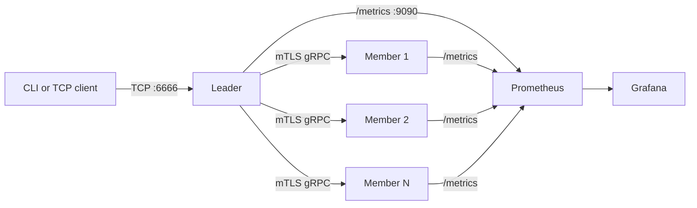

# Tolerex

[](https://github.com/YasinEnginExpert/Dagitik_Mesaj_Kayit_Servisi/actions/workflows/ci.yml)
[](LICENSE)

Tolerex is a compact distributed message-storage service written in Go. A single leader accepts a line-based TCP protocol, selects storage members, and replicates each message over mutually authenticated gRPC.

Tolerex is an educational storage system, not a production message queue. It does not provide ordering, delivery acknowledgements, leader election, consensus, automatic replica repair, or authenticated client access.

## Architecture



- The leader tracks membership, liveness, replica locations, and member load.
- Members store one file per message under `internal/data/member-<port>/messages/`.
- `TOLERANCE` is the required replica count. A write succeeds only after that many members store it.
- `least_loaded` and `p2c` (Power of Two Choices) placement strategies are available.
- Members send heartbeats every five seconds. Silent or failed members are excluded from new writes.
- Leader metadata is persisted under `internal/data/leader_state.json` and flushed on graceful shutdown.
- Leader/member gRPC traffic uses mTLS. The client-facing TCP protocol is plaintext.

## Requirements

Run commands from the repository root. Relative certificate, configuration, test-data, and runtime-data paths depend on it.

Required for local use:

- Git
- Go 1.26.10 or newer
- Windows PowerShell 5.1 or newer for the provided scripts and launcher
- Free default ports `5555`, `5556`, `5557`, `6666`, `9090`, `9092`, and `9093`

Required only for container deployment and dashboards:

- Docker Desktop or Docker Engine with the `docker compose` plugin
- Free host ports `3000`, `5555`, `6666`, `9090`, and `9091`

Verify the installed tools:

```powershell
go version
docker --version
docker compose version
```

`protoc` is not required unless `proto/message.proto` is changed; generated Go sources are committed.

## Get the project

```powershell
git clone https://github.com/YasinEnginExpert/Dagitik_Mesaj_Kayit_Servisi.git
Set-Location Dagitik_Mesaj_Kayit_Servisi
go mod download
```

Generate the local development CA and the `leader` and `member` certificates:

```powershell
go run ./cmd/certgen
```

The generated certificates and private keys are ignored by Git. If they already exist, keep them. Use `go run ./cmd/certgen -force` only when intentionally rotating the entire local CA, with all Tolerex processes and containers stopped.

## Quick start with Docker

This starts one leader, six members, Prometheus, and Grafana. Docker must be running.

1. Create the local Compose environment file:

   ```powershell
   Copy-Item .env.example .env
   notepad .env
   ```

   Replace `GRAFANA_ADMIN_PASSWORD=change-me` with a non-default local password, then save the file. The other entries document process defaults; the cluster Compose file sets its own container addresses and ports.

2. Validate and start the stack:

   ```powershell
   docker compose -f deploy/docker-compose.cluster.yml config --quiet
   docker compose -f deploy/docker-compose.cluster.yml up -d --build
   docker compose -f deploy/docker-compose.cluster.yml ps
   ```

3. Open the client:

   ```powershell
   go run ./cmd/client
   ```

4. Enter these commands at the `tolerex>` prompt:

   ```text
   STATUS
   SET 1 hello
   GET 1
   QUIT
   ```

   A healthy fresh cluster reports six live members and `tolerance=2`. The expected write/read responses are `OK` and `hello`.

5. Open monitoring:

   - Leader metrics: <http://127.0.0.1:9090/metrics>
   - Prometheus: <http://127.0.0.1:9091>
   - Grafana: <http://127.0.0.1:3000> (`admin` plus the password from `.env`)

6. Stop the stack while preserving its named volumes:

   ```powershell
   docker compose -f deploy/docker-compose.cluster.yml down
   ```

   Add `--volumes` only when all Docker-backed Tolerex and Grafana data should be permanently reset.

## Local start without Docker

Generate certificates first, then open four PowerShell terminals in the repository root. The first three commands remain running.

Terminal 1 — leader:

```powershell
go run ./cmd/leader
```

Terminal 2 — first member:

```powershell
go run ./cmd/member -port=5556 -metrics=9092 -io=buffered
```

Terminal 3 — second member:

```powershell
go run ./cmd/member -port=5557 -metrics=9093 -io=buffered
```

Terminal 4 — client:

```powershell
go run ./cmd/client
```

Run `STATUS` first. With the default `TOLERANCE=2`, writes require at least two live members. Stop each server with `Ctrl+C`; graceful leader shutdown flushes its latest metadata.

### Windows launcher

The launcher opens separate PowerShell windows for the leader, members, and clients:

```powershell
go run ./cmd/launcher
```

For the simplest interactive cluster, choose six members, zero clients, `buffered` I/O, and `least_loaded`. Blank input is accepted only where a numeric default is shown; the I/O mode and load-balancer strategy must be typed. Exiting the launcher does not stop the opened node processes.

## TCP protocol

The server sends `Tolerex ready` after connection. Every command and response is one CRLF-terminated line; commands are case-insensitive.

| Command | Result |
| --- | --- |
| `SET <id> <message>` | Stores or overwrites an ID and returns `OK` after the configured replica count succeeds. |
| `GET <id>` | Returns `VALUE <message>`, `NOT_FOUND`, or an error. The bundled client displays only `<message>`. |
| `STATUS` | Returns registered/live member counts, replica count, and mapped-message count. |
| `HELP` | Returns the wire-protocol command summary. |
| `QUIT` or `EXIT` | Returns `Bye` and closes the connection. |

Protocol limits:

- IDs are integers from `0` through `2147483647`.
- Messages must be non-empty and cannot contain a newline.
- A message can be at most 4 MiB.
- `FILE` and `<count> SET ...` are bundled-client helpers, not server protocol commands.

## Client modes

Common examples:

```powershell
# Interactive client with RTT output
go run ./cmd/client -measure

# Run randomized load for 30 seconds
go run ./cmd/client -duration 30s

# Write measurement rows to a CSV file
New-Item -ItemType Directory -Path measured -Force | Out-Null
go run ./cmd/client -measure -csv -duration 30s -id client-1 > measured/client-1.csv

# Four concurrent measured clients for 30 minutes
powershell -NoProfile -ExecutionPolicy Bypass -File .\scripts\run-stress-clients.ps1 -DurationMinutes 30 -Clients 4
```

| Flag | Default | Purpose |
| --- | --- | --- |
| `-addr` | `127.0.0.1:6666` | Leader address; comma-separated fallback addresses are accepted. |
| `-measure` | `false` | Measures request round-trip time. |
| `-csv` | `false` | Writes CSV to stdout; requires `-measure`. |
| `-flush` | `1000` | Bulk-operation batch size; measurement mode always uses `1`. |
| `-offset` | `0` | Starting ID offset for generated load. Use distinct offsets for concurrent clients. |
| `-id` | `client` | Client label written to CSV rows. |
| `-stress` | `0` | Stress duration in whole minutes. |
| `-duration` | `0` | Go duration such as `30s` or `5m`; overrides `-stress`. |

Stress mode uses the files under `test_data/` when available. Keep stdout redirected only when `-csv` is enabled; operational messages are written to stderr.

## Configuration

The default replica count is defined in `config/tolerance.conf`:

```text
TOLERANCE=2
```

Changing it affects new writes and requires at least that many live members. Restart the leader after changing the file.

Frequently used environment variables:

| Variable | Default | Applies to |
| --- | --- | --- |
| `BALANCER_STRATEGY` | `least_loaded` | Leader; accepts `least_loaded` or `p2c`. |
| `LEADER_GRPC_PORT` | `5555` | Leader/member gRPC endpoint. |
| `LEADER_TCP_BIND` | `127.0.0.1` | Client-facing bind address. |
| `LEADER_TCP_PORT` | `6666` | Client-facing TCP port. |
| `LEADER_METRICS_PORT` | `9090` | Leader Prometheus endpoint. |
| `LEADER_STATS_INTERVAL` | `0` | Terminal status refresh; use `0` or a duration such as `5s`. |
| `LEADER_ADDR` | `localhost:5555` | Member registration/heartbeat target. |
| `MEMBER_ADDR` | `localhost:<member-port>` | Dialable address advertised to the leader. |
| `MEMBER_GRPC_PORT` | `5556` | Member gRPC port when `-port` is omitted. |
| `MEMBER_METRICS_PORT` | `9092` | Member metrics port when `-metrics` is omitted. |
| `MEMBER_IO_MODE` | `buffered` | Member storage mode; accepts `buffered` or `unbuffered`. |
| `TOLERANCE_CONF` | `config/tolerance.conf` | Replica configuration file. |
| `TOLEREX_LOG_LEVEL` | `info` | `debug`, `info`, `warn`, or `error`. |
| `TOLEREX_LOG_FILE` | empty | Empty enables rotating files plus stderr; `off` uses stderr only. |
| `TOLEREX_LOG_DIR` | `logs` | Directory for rotating process logs. |
| `TOLEREX_BASE_DIR` | current directory | Optional repository path override used only by the Windows launcher. |

Certificate path and expected certificate-CN variables are listed in `.env.example`. Local Go commands do not automatically load `.env`; set variables in the current shell before starting a process. Compose reads `.env` for interpolation.

Example:

```powershell
$env:BALANCER_STRATEGY='p2c'
$env:TOLEREX_LOG_LEVEL='debug'
go run ./cmd/leader
```

## Testing and quality checks

Generate certificates before integration or chaos tests.

```powershell
# All package tests
powershell -NoProfile -ExecutionPolicy Bypass -File .\scripts\run-tests.ps1

# Package tests plus the Go race detector
powershell -NoProfile -ExecutionPolicy Bypass -File .\scripts\run-tests.ps1 -Race

# Storage and balancer benchmarks
powershell -NoProfile -ExecutionPolicy Bypass -File .\scripts\run-tests.ps1 -Bench

# Three-minute six-member process-chaos test
powershell -NoProfile -ExecutionPolicy Bypass -File .\scripts\run-chaos-test.ps1
```

The chaos test repeatedly kills and restarts one, two, or four members, rapidly flaps a member, hard-kills the leader after an acknowledged write, checks live canary writes/reads, and audits replica files. It uses isolated high ports and removes its generated binaries and data unless `-KeepArtifacts` is supplied.

Direct checks used by CI:

```powershell
go test ./... -count=1 -cover
go test -race ./... -count=1
go vet ./...
go mod verify
go run golang.org/x/vuln/cmd/govulncheck@v1.9.0 ./...
```

See [docs/testing.md](docs/testing.md) for the exhaustive test matrix and profiling command.

## Monitoring modes

The full-cluster Compose file includes application nodes and monitoring. To monitor six nodes running directly on the Windows host instead, start them first and run:

```powershell
docker compose -f deploy/docker-compose.yml up -d
```

Create `.env` from `.env.example` and set `GRAFANA_ADMIN_PASSWORD` before starting this stack. Its Prometheus configuration expects the leader on port `9090` and six member metrics endpoints on ports `9092` through `9097`, reached through `host.docker.internal`.

## Cleanup and reset

Preview local cleanup before deleting anything:

```powershell
powershell -NoProfile -ExecutionPolicy Bypass -File .\scripts\clean-test-artifacts.ps1 -DryRun
powershell -NoProfile -ExecutionPolicy Bypass -File .\scripts\clean-runtime-artifacts.ps1 -DryRun
powershell -NoProfile -ExecutionPolicy Bypass -File .\scripts\clean-docker-artifacts.ps1 -DryRun
```

Remove `-DryRun` to execute the selected cleanup. Runtime cleanup permanently removes local logs, measured CSV files, leader metadata, and member message files. Docker cleanup is project-scoped but permanently removes the project's containers, volumes, networks, and locally built images.

## Troubleshooting

| Symptom | Check |
| --- | --- |
| `Failed to load ... credentials` | Run `go run ./cmd/certgen` from the repository root. If files already exist, verify their paths rather than replacing them immediately. |
| `ERROR: store failed` | Run `STATUS`; `alive` must be at least the configured `tolerance`. Check member terminals for registration or mTLS errors. |
| A member keeps retrying registration | Start the leader first and verify `LEADER_ADDR`, `MEMBER_ADDR`, ports, and certificates. |
| `bind: ... address already in use` | Stop the older Tolerex process/container or choose a consistent unused application and metrics port. |
| Docker reports that the daemon is unavailable | Start Docker Desktop/Engine, then rerun `docker info`. |
| Compose rejects `GRAFANA_ADMIN_PASSWORD` | Create `.env` from `.env.example` and replace `change-me`. |
| Old members appear in `STATUS` | Stop local nodes, preview `clean-runtime-artifacts.ps1 -DryRun`, then run it if the stored messages may be discarded. |
| Grafana has no member data in host-monitoring mode | Start six local members with metrics ports `9092`-`9097`, or use the full-cluster Compose file. |

## Operational boundaries

- There is one leader and no election or consensus protocol.
- Leader metadata writes are batched; there is no write-ahead log.
- Failed replicas are not automatically repaired or rebalanced.
- Development certificates reuse role identities and are unsuitable for production.
- Client TCP traffic has no TLS or authentication.
- Member files and leader metadata are local-disk state, not a backup strategy.

For production-oriented work, add consensus-backed leader failover, durable transactional metadata, replica repair, client authentication/TLS, per-node identities, resource quotas, and backup/restore procedures.

## Repository layout

```text
cmd/          Executables: leader, member, client, launcher, certificate generator
config/       Replica-count configuration and generated local TLS files
deploy/       Docker Compose, Prometheus, and Grafana provisioning
docs/         Testing notes, roadmap, and references
internal/     Storage, balancing, security, middleware, and server packages
proto/        Protocol Buffer schema and generated Go sources
scripts/      Test, stress, chaos, and scoped-cleanup helpers
test_data/    Payloads used by FILE and stress-client modes
```

Additional documentation:

- [Testing](docs/testing.md)
- [Deployment details](deploy/manual.md)
- [Roadmap](docs/roadmap.md)
- [References](docs/references.md)

## License

Tolerex is available under the [MIT License](LICENSE).
